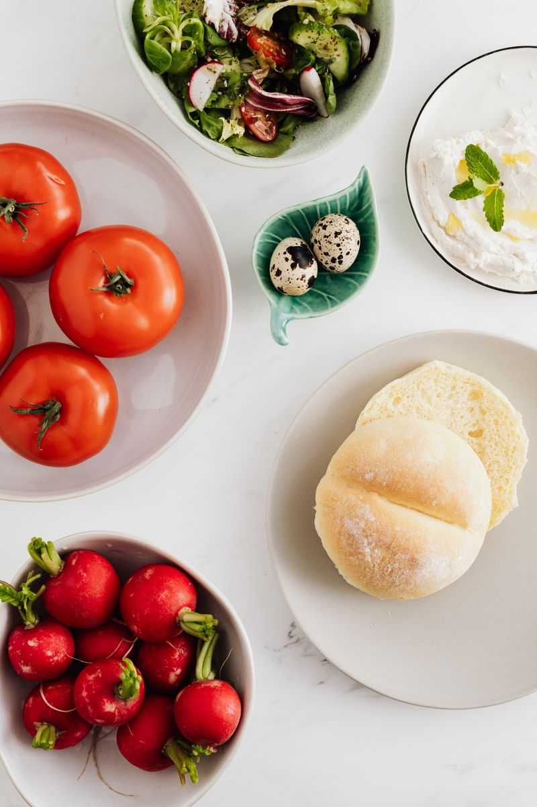

# 🌾 Krishi Market

**A farmer-to-consumer agri marketplace that connects local farmers in Karnataka directly with customers — no middlemen.**

A frontend-only static prototype: browse fresh produce, manage a cart and check out as a customer, or register a farm, list products with photos, track stock and fulfil orders in the farmer portal.

[](https://nandanandugula8999-ops.github.io/Farmer-to-Consumer-Agri-Marketplace/)
[](#tech-stack)
[](#tech-stack)
[](#tech-stack)
[](#deployment)



---

## ✨ Features

### 🛒 Storefront
- Home page with hero search and featured produce
- Shop with text search, category/method filters, sorting and pagination
- Product detail pages with image gallery, quantity picker and related products
- Farmer directory and individual farm profiles
- Categories overview, About, How it works and FAQ pages
- Contact form with client-side validation (simulated submission)
- Cart with quantity controls, delivery-fee logic (free over ₹499) and demo checkout

### 🧑‍🌾 Farmer portal
- **Farm registration** — name, contact details, farm name, location, description, product categories, farming method and approval status
- **Dashboard stats** — total products, available products, total demo orders and demo earnings
- **Product management** — add, edit and delete listings with name, description, price, unit, category, stock quantity and availability
- **Image upload** — compressed in-browser and previewed (up to 3 photos; category image fallback)
- **Order management** — orders containing the farmer's products with customer delivery details, item totals and farmer earnings
- **Order tracking** — simulated status updates (placed → packed → out for delivery → delivered / cancelled) and order history
- **Demo helpers** — sign in to a seeded farm, generate demo orders, reset demo data and sign out

### ♿ General
- Responsive from 320 px phones up to desktop
- Hash-based routing that works on any static host, including project subpaths
- Accessible labels, keyboard-friendly controls, skip link and reduced-motion support
- No build step and no runtime dependencies

---

## 🧰 Tech Stack

| Layer | Choice |
| --- | --- |
| Markup | HTML5 |
| Styling | Plain CSS (custom properties, flexbox, grid) |
| Logic | Vanilla JavaScript (ES6) with a hash router |
| Data | In-browser `localStorage` with in-memory fallback |
| Fonts | Google Fonts (Inter, Manrope) |
| Hosting | GitHub Pages via GitHub Actions |

---

## 📁 Project Structure

```
krishi-market/
├── index.html                    # Single page shell + header/footer
├── favicon.svg
├── css/
│   └── style.css                 # All styles and responsive breakpoints
├── js/
│   ├── data.js                   # Seeded categories, farms, products, reviews
│   ├── store.js                  # Farmer accounts, products/orders + localStorage
│   └── app.js                    # Router, page renderers, cart and event handling
├── images/                       # Product, farm and category photography
└── .github/workflows/deploy.yml  # GitHub Pages deployment workflow
```

---

## 🚀 Run Locally

No install or build step required.

1. Clone the repository:
   ```bash
   git clone https://github.com/nandanandugula8999-ops/Farmer-to-Consumer-Agri-Marketplace.git
   cd Farmer-to-Consumer-Agri-Marketplace
   ```
2. Open `index.html` in a modern browser, **or** serve the folder:
   ```bash
   # Python
   python -m http.server 8000

   # Node.js
   npx serve .
   ```
3. Visit `http://localhost:8000`.

---

## 🗺️ Routes

| Route | Page |
| --- | --- |
| `#/` | Home |
| `#/shop` | Shop (supports `q`, `category`, `method`, `sort`, `page`) |
| `#/product/:id` | Product detail |
| `#/categories` | Categories |
| `#/farmers` | Farmer directory |
| `#/farmers/:id` | Farm profile |
| `#/about` | About |
| `#/how-it-works` | How it works |
| `#/faq` | FAQ |
| `#/contact` | Contact |
| `#/cart` | Cart and checkout |
| `#/farmer` | Farmer dashboard / onboarding |
| `#/farmer/register` | Farm registration and profile editing |
| `#/farmer/orders` | Farmer orders (supports `status`) |
| `#/farmer/products/new` | Add a product |
| `#/farmer/products/:id/edit` | Edit a product |

---

## 🧑‍🌾 Trying the Farmer Portal

1. Open **Farmer** in the navigation.
2. Click **Explore demo dashboard** to sign in as the seeded demo farm, or **Register your farm** to create your own.
3. Add products, toggle stock availability and generate demo orders.
4. On **Orders**, expand an order to see customer delivery details and change its status.

Customer checkouts create order records that appear on the matching farmers' dashboards.

---

## 💾 Data Persistence

Everything is stored locally in the browser:

| Key | Contents |
| --- | --- |
| `krishi-cart-v1` | Shopping cart |
| `krishi-farmer-account-v1` | Registered farm profile |
| `krishi-farmer-products-v1` | Custom products, edits and deletions of seeded products |
| `krishi-orders-v1` | Demo orders and customer checkouts |

Data is per-browser and per-device. Clearing site data or using **Reset demo data** on the dashboard restores the original demo content.

---

## 📦 Deployment

The repository includes a GitHub Actions workflow that publishes the site to GitHub Pages.

1. Go to **Settings → Pages**.
2. Set **Build and deployment → Source** to **GitHub Actions**.
3. Run the **Deploy static site to GitHub Pages** workflow (or push to `main`).

The site is then available at:

```
https://<username>.github.io/<repository>/
```

All asset paths are relative and routing is hash-based, so the site works from a project subpath without extra configuration.

---

## ⚠️ Limitations

This project is intended as a frontend demo/portfolio piece, **not** a production marketplace:

- No backend, database, authentication or server-side validation
- Checkout, contact messages, approvals and order status changes are simulated
- Payment is not processed and no emails or notifications are sent
- `localStorage` is limited in size; very large image uploads can exceed the quota (the UI falls back to session-only storage)
- Farm approval status can be changed by the user for demonstration purposes

---

## 🙏 Credits

- Product and farm photography sourced from Flickr and Wikimedia Commons; individual credits are linked in the site footer.
- Fonts served by Google Fonts.

---

## 📄 License

No license file is included. Add a license before reusing the code outside this demo.
